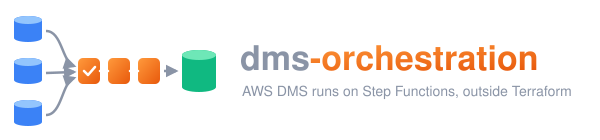

<p align="center"></p>

# dms-orchestration

Runs AWS DMS replication tasks **outside Terraform**, step by step, with AWS Step Functions.
Terraform (any dms module that satisfies [the contract](docs/upstream-modules-contract.md))
creates the DMS instance, endpoints and tasks with `start = false`; this module adds the
orchestration around them: checks before the start, the start itself, post-work or a failure
branch, a report, and one run per task at a time. `terraform apply` never starts a migration.

```
operator / CI ──► migrate: lock ─ inspect task ─ pre-flight verdict ─ [assessment] ─ pre-jobs
                           ─ [dump] ─ [reset] ─ arm ─ StartReplicationTask ─ end (no waiting)
AWS DMS ──event──► dms_event_handler ─ claim ─► post: post-jobs | classify ─ [auto-resume]
                           ─ on-failure jobs ─ baseline ─ report ─ SNS ─ unlock
jobs:   job-runner ─► Lambda (built-ins, SQL) | SSM runner from your AMI (pg_dump, scripts) | [Fargate]
state:  DynamoDB (locks, runs, baselines) · S3 (job sets, reports, dumps) · SSM (registration)
safety: watchdog every 5 min (lost events, dead executions, orphaned locks) · release_lock
```

Start here:

* [Getting started](docs/getting-started.md): the first deployment and the first run.
* [Architecture](docs/architecture.md): one page on components, data and decisions.
* [RUNBOOK.md](RUNBOOK.md): operating runs, every outcome and failure category with its next step.
* [Troubleshooting](docs/troubleshooting.md): symptoms from AWS, their cause and the fix.
* Reference: [configuration](docs/configuration.md) (module inputs and outputs),
  [job contract](docs/job-contract.md), [state machines](docs/state-machine.md),
  [pre-flight](docs/preflight.md), [security](docs/security.md), [ADRs](docs/adr/).
* A throw-away end-to-end stack: [examples/sandbox](examples/sandbox/README.md).

## Use the module

Terraform 1.9.8, `hashicorp/aws >= 5.90, < 6`. In the migration workspace, next to the dms module:

```hcl
module "dms_orchestration" {
  source = "git::ssh://git@github.com/<org>/dms-orchestration.git//modules/dms-orchestration?ref=v0.2.0"

  environment = "dev"
  vpc_id      = var.vpc_id
  subnet_ids  = var.db_tier_subnet_ids          # >= 2 private subnets

  dms = {                                       # outputs of the dms module
    replication_instance_arn = module.dms.replication_instance_arn
    replication_instance_id  = module.dms.replication_instance_id
    task_arns                = module.dms.task_arns
    task_resource_ids        = module.dms.task_resource_ids
    endpoint_arns            = module.dms.endpoint_arns
    log_group_name           = module.dms.log_group_name
  }

  projects = {
    ledger = {
      tasks = {
        core = {                                # taskKey; must exist in dms.task_arns
          connections = {
            source = { engine = "postgresql", secret_arn = var.source_runner_secret_arn,
                       data_api_cluster_arn = var.source_cluster_arn }
            target = { engine = "postgresql", secret_arn = var.target_runner_secret_arn,
                       data_api_cluster_arn = var.target_cluster_arn }
          }
          jobs = {                              # job set version in S3, pinned by its hash
            default_version = "3f2c1ab"
            bundles         = { "3f2c1ab" = var.jobs_bundle_sha256 } # sync-jobs.sh prints it
          }
          defaults = { target_reset_policy = "if-interrupted" }
        }
      }
    }
  }

  job_secret_arns             = [var.source_runner_secret_arn, var.target_runner_secret_arn]
  kms_key_arn                 = var.kms_key_arn  # "" only in a sandbox
  database_security_group_ids = [var.target_db_security_group_id, var.source_db_security_group_id]
}
```

Every input and output: [docs/configuration.md](docs/configuration.md). Outside a sandbox also
pass `sns_topic_arn`, `table_name` and `artifacts_bucket_name` from a long-lived workspace
(RUNBOOK §9–10). The module creates no VPC endpoints, KMS key policies or operator roles; it
publishes what they must allow (`network_contract`, `kms_key_policy_requirements`,
`bucket_requirements`, `operator_policy_json`, `jobset_publisher_policy_json`). A brought
artifacts bucket must be versioned; `modules/artifacts-bucket` creates one with every control.
`create = false` creates nothing.

Footprint: Lambda functions from zips the module packages from its own directory (or a prebuilt
zip, `lambda.artifact_s3_*`), three Step Functions state machines, IAM roles (one job role per
project), SSM parameters, alarms and, unless you bring them, a DynamoDB table, an S3 bucket and
an SNS topic; the module's tags include `ManagedBy` and `Module`. No ECS cluster, no ECR
endpoints and no container image by default: SQL jobs run in a Lambda, long jobs
(`pg_dump`/`pg_restore`, long DDL, scripts) on SSM-managed instances built from your AMI
(`ssm`; one runner per project, since projects sharing a runner are not isolated from each
other), and Fargate is an optional third runtime that appears only with `fargate.images`, a
pre-pushed image pinned by digest. The module never builds an image
([ADR 0011](docs/adr/0011-job-runtimes.md)).

## Run a migration

```bash
scripts/sync-jobs.sh ledger 3f2c1ab examples/jobs/postgres-basic                      # upload a job set version
python scripts/orch.py start --project ledger --task core --operation plan --wait     # what would happen
python scripts/orch.py start --project ledger --task core --dry-run --wait            # jobs in dry mode, no DMS start
python scripts/orch.py start --project ledger --task core --wait --change-ref CHG123  # migrate, DMS, post
python scripts/orch.py report <runId>
python scripts/orch.py gate <runId>                                                   # exit 0: may be promoted
```

Run request fields: [`run_request.schema.json`](modules/dms-orchestration/src/shared/schemas/run_request.schema.json).
Job sets (pre, reset, post and on-failure jobs, versioned in S3): [docs/job-contract.md](docs/job-contract.md),
examples [minimal](examples/jobs/minimal) and [postgres-basic](examples/jobs/postgres-basic).

## Repository

```
modules/dms-orchestration/   Terraform module (+ asl/ state machines, tests/ terraform test)
  src/shared/                decision logic, pre-flight, handoff (migrate -> post), DynamoDB store, schemas
  src/lambdas/               one directory per Lambda handler (packaged by the module)
  src/jobs/sql-runner/       SSM runtime zip and optional Fargate image: orch_job.py, psql-run, dumps, verify-target
modules/artifacts-bucket/    optional long-lived artifacts bucket with the controls of bucket_requirements
examples/jobs/               example job sets
examples/sandbox/            throw-away stack and the e2e scenarios
scripts/                     orch.py (CLI), sync-jobs.sh, jobset_tool.py, verify_destroyed.py, check_denylist.py
tests/                       pytest, local ASL runner, TestState cases, e2e seed data
docs/                        getting started, architecture, contracts, troubleshooting, testing, ADRs
```

## Development

```bash
uv sync               # Python 3.13 + dev tools
make lint test        # ruff, terraform fmt, job set checks, pytest, terraform test
make teststate-dry    # build the TestState requests (no AWS)
```

The cycle, the commit rules and the denylist gate: [CONTRIBUTING.md](CONTRIBUTING.md); for coding
agents: [AGENTS.md](AGENTS.md). Test levels and the e2e matrix: [docs/testing.md](docs/testing.md).

## Release 0.2.0

Hardening and new job runtimes: run artifacts per project and a pinned run context, job sets
pinned by hash, a transactional restore scoped to the dump's tables under the task lock, DMS
validation failing the run by default, SQL jobs in a Lambda and long jobs on SSM with Fargate
optional, and the registry conventions (`create`, non-nullable inputs, KMS key policy contract
v2). 0.2.0 has breaking changes for 0.1 deployments, runs and dumps; each is listed under
*Changed* in [CHANGELOG.md](CHANGELOG.md).

## License and security

MIT, see [LICENSE](LICENSE). Report vulnerabilities privately as described in
[SECURITY.md](SECURITY.md); the security model is in [docs/security.md](docs/security.md).
